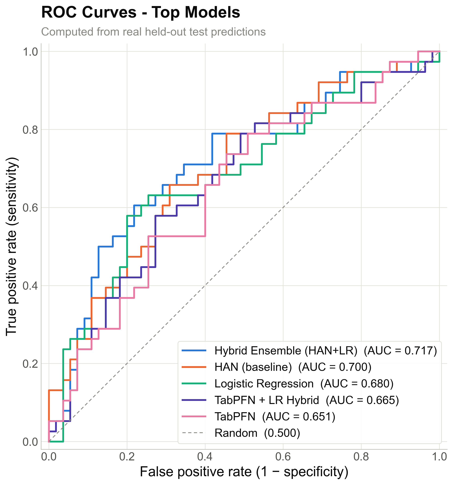
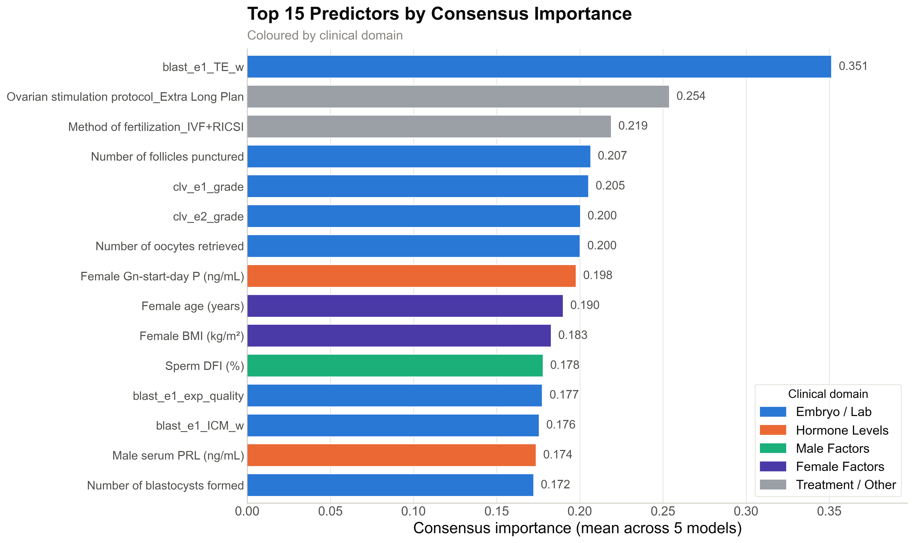

# Live-birth prediction after fresh embryo transfer in IVF/ICSI

Code, data documentation, and figures for **"A curated single-centre dataset and a
hybrid attention–logistic regression ensemble for live-birth prediction after fresh
embryo transfer in IVF/ICSI."**

The repository contains everything needed to reproduce the study end-to-end: the
curated 616-cycle cohort, the embryo-morphology encoding, an eleven-model benchmark,
the ablations, and every figure and table reported in the manuscript.


---

## Headline result

A compact **Hybrid Attention Network (HAN)** combined with **logistic regression (LR)**
gives the best discrimination on the held-out test set, beating both of its own
components and the tabular foundation-model baselines.

| Rank | Model | AUC-ROC | Accuracy | Precision | Recall | F1 |
|---:|---|---:|---:|---:|---:|---:|
| 1 | **HAN + LR (proposed)** | **0.717** | 0.699 | 0.639 | 0.605 | 0.622 |
| 2 | HAN backbone (alone) | 0.700 | 0.645 | 0.571 | 0.526 | 0.548 |
| 3 | Logistic regression | 0.680 | 0.645 | 0.558 | 0.632 | 0.593 |
| 4 | TabPFN + LR | 0.665 | 0.645 | 0.619 | 0.342 | 0.441 |
| 5 | TabPFN | 0.651 | 0.624 | 0.588 | 0.263 | 0.364 |
| 6 | Support-vector machine | 0.628 | 0.634 | 0.625 | 0.263 | 0.370 |
| 7 | XGBoost&nbsp;<sup>[†](#implementation-notes)</sup> | 0.626 | 0.613 | 0.533 | 0.421 | 0.471 |
| 8 | *k*-nearest neighbours | 0.623 | 0.645 | 0.586 | 0.447 | 0.508 |
| 9 | Gradient boosting | 0.616 | 0.602 | 0.522 | 0.316 | 0.393 |
| 10 | Naive Bayes | 0.593 | 0.570 | 0.486 | 0.895 | 0.630 |
| 11 | Random forest | 0.560 | 0.624 | 0.600 | 0.237 | 0.340 |

93 held-out test cycles. Full precision in [`results/model_results.csv`](results/model_results.csv).

<p align="center">
  
</p>

---

## What is in here

```
.
├── compare_13models_fixed.py     benchmark: data pipeline + 11 models + importance
├── run_and_visualize.py          single entry point: runs the benchmark, writes
│                                 results/ and figures/
├── data/
│   ├── updated_method_encoded.07.25.xlsx    616 cycles x 72 columns
│   └── README.md                            cohort description, ethics, terms of use
├── docs/
│   └── dataset_encoding_documentation.md    column-by-column encoding reference
├── results/                      tables regenerated on every run
│   ├── model_results.csv                    metrics per model, ranked by AUC
│   ├── selected_features_all50.csv          the 50 selected features, ranked
│   ├── selected_features_by_category.txt    the same list grouped by domain
│   ├── category_importance.csv              importance per clinical domain
│   └── results_summary.json                 every scalar result in one file
├── figures/                      all figures, regenerated on every run (.png + .pdf)
├── paper/
│   └── paper_review_26_august.tex           manuscript source (review version)
├── requirements.txt
├── CITATION.cff
└── LICENSE
```

---

## Quick start

```bash
git clone <repository-url>
cd ivf-live-birth-prediction
python -m venv .venv && source .venv/bin/activate   # Windows: .venv\Scripts\activate
pip install -r requirements.txt
python run_and_visualize.py
```

That one command runs the whole study. It prints the full analysis to the terminal,
overwrites the five tables in `results/`, and regenerates all 17 figures in
`figures/` as both `.png` and `.pdf`. Nothing is hardcoded — every number in every
figure is read from the live run.

Runtime is a few minutes on a CPU-only laptop; no GPU is needed.

To run against a copy of the dataset stored outside the repository:

```bash
IVF_DATA_FILE=/secure/path/updated_method_encoded.07.25.xlsx python run_and_visualize.py
```

---

## The data

616 fresh embryo-transfer cycles from the Reproductive Medicine Center of Zhongnan
Hospital, Wuhan University (February 2018 – November 2025). One row is one cycle.

| | |
|---|---|
| Outcome | live birth (251, 40.7%) vs. non-live birth (365, 59.3%) |
| Columns | 72 — 62 clinical + 10 embryo-morphology encoding columns |
| Predictor domains | female factors, male factors, stimulation and laboratory, oocyte retrieval and embryo development |
| Ethics | Zhongnan Hospital of Wuhan University, approval No. 2025346K; consent waived (retrospective) |

Details, terms of use, and the no-identifiers statement are in
[`data/README.md`](data/README.md).

### Differential ICM/TE weighting for blastocyst morphology

The methodological contribution on the data side. Raw morphology text describing one
or two transferred embryos, in either the Gardner blastocyst system or the
cleavage-stage system, is converted into ten numeric columns — separate slots per
embryo, separate columns per system, so the two scales never mix.

Conventional Gardner grading treats the inner cell mass (ICM) and trophectoderm (TE)
as equally informative. In this cohort TE was more strongly associated with live
birth, so the composite stores **ICM at half weight and TE at full weight**:

| Component | Mapping | Stored as |
|---|---|---|
| Blastocyst ICM | A/B/C → 3/2/1 | grade × **0.5** |
| Blastocyst TE | A/B/C → 3/2/1 | grade × **1.0** |
| Cleavage grade | I–IV → 4–1 | grade |
| Blastocyst expansion | 3–4 optimal → 2; 1,2,5,6 → 1; none → 0 | inverted-U score |
| Cleavage cell count | 8 → 3; 7 or 9 → 2; else → 1; none → 0 | inverted-U score |

This separates blastocysts that share an expansion stage but carry mirror-image
grades, ranking the TE-superior 4BA above 4AB — a distinction equal-weight grading
cannot make. Two clinically non-monotonic facts (cell count peaks near eight cells,
expansion peaks at intermediate stages) get their own inverted-U optimality scores.

The full derivation, including worked examples, is in
[`docs/dataset_encoding_documentation.md`](docs/dataset_encoding_documentation.md).

---

## The pipeline

Everything is fit on the training split only; the test set is untouched until
evaluation.

1. **Target** — mapped by meaning, so live birth is always the positive class. A
   plain `LabelEncoder` would sort alphabetically and pick "Non-live birth" as
   class 1, silently inverting precision, recall, and F1.
2. **Feature typing** — numerical and categorical columns are declared explicitly by
   domain knowledge, not auto-detected, so numeric columns can never be one-hot
   encoded by accident. `Female weight (kg)` is dropped as collinear with BMI
   (r = 0.88, VIF ≈ 6.7).
3. **Stratified 85/15 split** — 523 training and 93 test cycles, before any fitting.
4. **Impute** — `KNNImputer(n_neighbors=5)`, fit on train.
5. **Scale** — `RobustScaler` (median/IQR), fit on train.
6. **One-hot encode** — 8 categorical columns → 15 dummies, first level dropped.
   76 candidate features in total.
7. **Select** — `SelectKBest(f_classif, k=50)`, fit on train.

## The model

**HAN backbone.** A global, dataset-level learnable importance gate (a weight vector
passed through a sigmoid and multiplied element-wise with the inputs) followed by a
compact MLP: 50→24 with LayerNorm, ReLU, dropout 0.25; 24→12 with ReLU, dropout 0.15;
12→1 with sigmoid. Unlike per-sample transformer attention, the gate is shared across
the cohort, which keeps the parameter count tiny and suits a few hundred samples.
**1,635 trainable parameters per instance.** Three independently seeded instances
(42, 123, 456) are averaged to reduce initialization variance.

**HAN + LR ensemble.** A convex combination of the HAN ensemble and an L2-regularized
logistic regression trained on the same features:

```
p = w · p_HAN + (1 − w) · p_LR
```

`w = 0.70` was selected on a validation split carved out of the training data — never
on the test set. The whole ensemble is **4,957 parameters** (3 × 1,635 HAN + 51 LR +
the mixing weight), small enough to train in minutes and audit by hand.

**Training.** AdamW (lr 0.002, weight decay 0.001), binary cross-entropy, up to 80
epochs, batch size 32, Xavier initialization, gradient clipping at max-norm 1.0, and
the best-AUC checkpoint restored at the end.

---

## Feature importance

Five models expose a native importance measure: Gini importance (random forest),
Friedman MSE improvement (gradient boosting), gain-based weight (XGBoost), absolute
coefficient magnitude (logistic regression), and the learned attention weights (HAN).
These live on different scales, so they are min-max scaled within each model and
averaged into a consensus ranking.

<p align="center">
  
</p>

The differentially weighted **trophectoderm feature ranks first overall** (4.50% of
consensus importance), which is the empirical counterpart of the encoding decision
above. Aggregated by clinical domain:

| Domain | Share of consensus importance | Selected features |
|---|---:|---:|
| Embryo / laboratory | 41.0% | 19 |
| Hormone levels | 30.8% | 17 |
| Treatment / other | 10.9% | 5 |
| Male factors | 10.7% | 6 |
| Female factors | 6.6% | 3 |

Embryo/laboratory and hormonal variables together account for **71.8%** of total
importance. Note that model families disagree markedly about which predictors matter
— tree ensembles concentrate on continuous physiological variables and assign almost
nothing to sparse binary dummies, while logistic regression does the opposite — so a
single-model ranking would mislead. Both the consensus and the per-model detail are
reported for that reason.

---

## Figures

Regenerated from live results on every run, as `.png` (300 dpi) and `.pdf`.

**Manuscript figures**

| File | Content |
|---|---|
| `fig_encoding_scheme` | embryo morphology encoding scheme |
| `fig_roc_curves` | ROC curves, top five models |
| `fig_feature_importance` | top 15 predictors by consensus importance |
| `fig_importance_by_model` | per-model importance heatmap of the top 15 |
| `fig_category_importance` | share of importance per clinical domain |
| `fig_mixing_weight` | sensitivity to the ensemble mixing weight *w* |

**Supplementary**

| File | Content |
|---|---|
| `figure1_model_comparison` | all 11 models ranked by AUC-ROC |
| `figure2_feature_importance` | all 50 selected features by importance |
| `figure3_category_comparison` | best vs. average AUC per model family |
| `figure4a`–`figure4d` | class balance, feature domains, pipeline funnel, train/test split |
| `figure5_ablation_study` | architecture, mixing-weight, and dropout ablations |
| `figure6_metrics_comparison` | all five metrics for the top five models |
| `figure7_roc_curves` | ROC curves (same plot as `fig_roc_curves`) |
| `figure8_encoding_impact` | encoding scheme (same plot as `fig_encoding_scheme`) |

The manuscript's `\includegraphics` paths are relative to `figures/`, so compile the
LaTeX from the repository root, or copy `figures/` next to the `.tex` file.

---

## Reproducibility

Seeds are fixed throughout (`numpy`, `torch`, every scikit-learn estimator, and the
three HAN seeds), so a fresh run on the pinned environment reproduces the published
tables exactly. The results committed to `results/` were produced by the code as it
stands.

**Pin `pandas < 3.0`.** From pandas 3.0 onward, `Series.astype(str)` no longer renders
missing values as the literal string `"nan"`. Several categorical columns are blank
precisely for the patients they do not apply to — for example, cleavage-embryo counts
are missing for blastocyst transfers — so those `..._nan` dummies are informative
transfer-type indicators, not noise. Without them the feature matrix has 74 columns
instead of 76, feature selection picks a different set, and the numbers shift. The
version in `requirements.txt` is the one used for the reported results.

**TabPFN is optional.** If the `tabpfn` package is missing or fails to load, models 8
and 9 fall back to a constant 0.5 probability and are reported at AUC-ROC 0.500. Every
other model is unaffected, so the rest of the table still reproduces.

Verified environment: Python 3.12.7, numpy 2.3.4, pandas 2.3.3, scikit-learn 1.6.1,
scipy 1.16.0, torch 2.7.1, matplotlib 3.10.6, openpyxl 3.1.5, tabpfn 2.2.1.

---

## Implementation notes

Naming and configuration details that a reader of both the paper and the code will
want, so nothing looks like a discrepancy:

- **`IHAN` in the code is `HAN` in the paper.** The class is named `IHANModel` and
  results keys use `IHAN`; `run_and_visualize.py` renames it to `HAN` for every
  figure and table it writes.
- **Model 7, labelled "XGBoost", is currently instantiated as scikit-learn's
  `GradientBoostingClassifier(n_estimators=200, max_depth=5, learning_rate=0.1)`** —
  a second, differently tuned gradient-boosting configuration, not the `xgboost`
  package. That is why `xgboost` is not in `requirements.txt`. Model 3, "Gradient
  Boosting", is `GradientBoostingClassifier(n_estimators=150, max_depth=4)`.
- **`compare_13models_fixed.py` compares 11 models.** The filename is historical.
- The mixing weight `w` is chosen from the coarse grid {0.3, 0.5, 0.7} on a stratified
  validation split of the training data. `figures/fig_mixing_weight` additionally
  plots a finer sweep over w ∈ [0, 1] on that same validation split, for sensitivity.

### Scope of this release

The code here reproduces the eleven-model comparison, the ablations, the consensus
importance analysis, and every figure and table listed above. Two items reported in
the manuscript are produced by separate scripts that are not part of this release:
the text-serialized language-model baselines (MiniLM, DistilBERT, BERT, ELECTRA,
RoBERTa) and the bootstrap confidence intervals.

---

## Citation

If you use this dataset, the encoding scheme, or this code, please cite the article.
Machine-readable metadata is in [`CITATION.cff`](CITATION.cff).

> Shahzad AR, Chen J, Zhang M, Deng J. A curated single-centre dataset and a hybrid
> attention–logistic regression ensemble for live-birth prediction after fresh embryo
> transfer in IVF/ICSI. Manuscript under review, 2026.

Abdul Raheem Shahzad and Chen Jinxin contributed equally and share first authorship.
Corresponding authors: Ming Zhang (whu_mz@163.com) and Juan Deng (dengjuan@whu.edu.cn).

## License

Code is released under the [MIT license](LICENSE). The dataset in `data/` and the
manuscript source in `paper/` are **not** covered by it — see [`data/README.md`](data/README.md)
and the note at the end of `LICENSE`.

## Intended use

Research software. This is a retrospective, single-centre, internally validated model
that has **not** been externally validated, calibrated, or approved for clinical use.
It is not a medical device and must not be used to guide patient care. External
multi-centre validation, probability calibration, and a clinically motivated decision
threshold are the necessary next steps.
